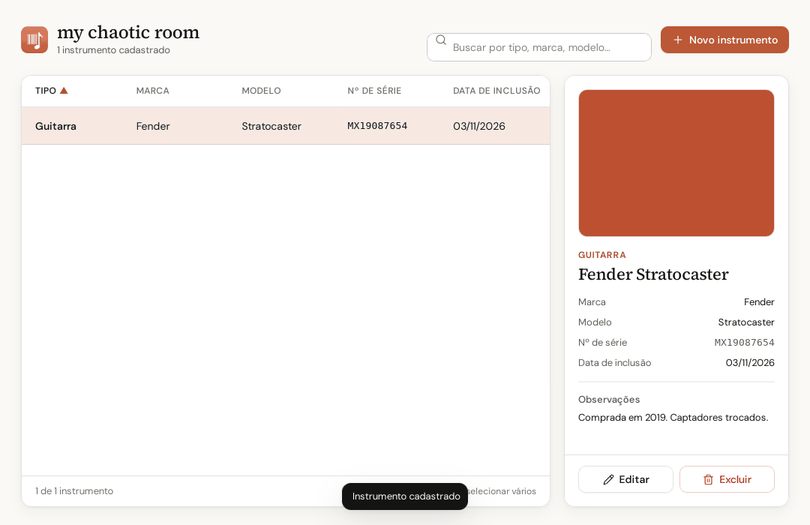
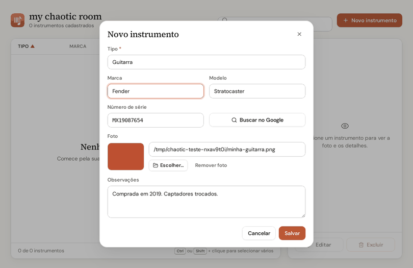
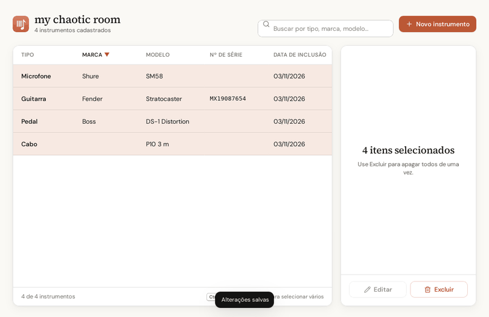
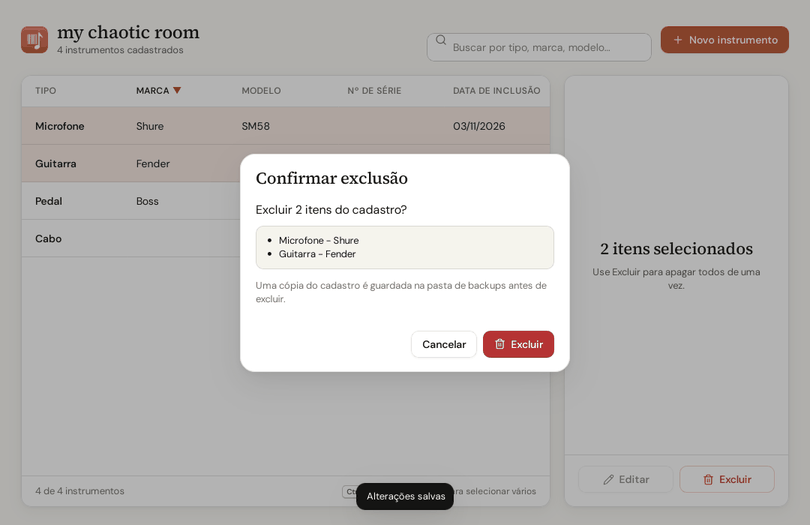

# my chaotic room

Aplicativo de janela para Windows e Mac para cadastrar e organizar seus instrumentos musicais e equipamentos
(guitarras, pedais, sintetizadores, microfones, cabos e o que mais morar na sua sala).
Os dados ficam num banco SQLite local, no seu computador.

- Visual no estilo dos apps do Claude (design system **Argila**, em `ui/ds/`): fundo creme, laranja terracota,
  títulos em serifa e **tema escuro automático** que segue o Windows/Mac
- Lista em ordem alfabética, que pode ser reordenada clicando no cabeçalho de qualquer coluna
- Busca rápida por tipo, marca e modelo
- Cadastro com tipo, marca, modelo, número de série, foto e observações
- Campo **Tipo** com autocompletar: digite uma letra e aparecem os tipos que começam com ela
- Painel de detalhes com a foto do instrumento selecionado (clique na foto para abri-la)
- Seleção múltipla para excluir vários itens de uma vez (`Ctrl`/`⌘` ou `Shift` + clique), com confirmação
- Atalhos: setas para andar na lista, `Enter` para editar, `Delete` para excluir, `Esc` para limpar a seleção
- Botão **Buscar no Google** no cadastro, que pesquisa só pela marca e modelo
- Data de inclusão no formato DD/MM/AAAA



| Cadastro | Vários selecionados | Confirmar exclusão |
|---|---|---|
|  |  |  |

## Baixar e usar (Windows)

1. Abra a página de [**Releases**](https://github.com/vonhauke/my-chaotic-room/releases/latest) e baixe o arquivo **my chaotic room.exe**.
2. Dê dois cliques nele. Não precisa instalar nada, nem o Python.

> Na primeira vez, o Windows pode mostrar um aviso azul (SmartScreen), porque o programa não é assinado.
> Clique em **Mais informações → Executar assim mesmo**.

Cada pessoa começa com o cadastro vazio. Os dados ficam no próprio computador, em `%APPDATA%\my chaotic room`
(no Mac, em `~/my chaotic room`).

## Rodar pelo código-fonte

Se preferir rodar sem o `.exe`, você precisa de:

- Windows ou Mac (no Linux, também o WebKit: `sudo apt install python3-gi gir1.2-webkit2-4.1`)
- Python 3.10+

## Como usar

```
pip install -r requirements.txt
python app.py
```

Ou dê dois cliques em `Abrir.bat`, que abre o app sem a janela do terminal.

1. Clique em **＋ Novo instrumento**, escolha o tipo e preencha o que quiser. Só o tipo é obrigatório.
2. Clique num instrumento da lista para ver a foto e os detalhes. Clique numa área vazia para limpar a seleção.
3. Use **Editar** e **Excluir** no painel de detalhes. Com `Ctrl` ou `Shift` você seleciona vários itens para excluir juntos.

## Onde ficam os dados

Tudo é guardado no computador de quem usa e **não vai para o GitHub** (está no `.gitignore`). No `.exe`, fica em `%APPDATA%\my chaotic room` (no `.app` do Mac, em `~/my chaotic room`); rodando pelo código-fonte, fica ao lado do `app.py`:

| Pasta/arquivo | O que é |
|---------------|---------|
| `instrumentos.db` | Banco SQLite com o cadastro |
| `fotos/` | Cópia de cada foto escolhida, para o app não depender do arquivo original |
| `backups/` | Cópia do banco feita toda vez que o app abre e antes de qualquer exclusão (guarda as 20 mais recentes) |

Para trocar de computador, copie essa pasta inteira (ou pelo menos `instrumentos.db` e `fotos/`).

## Gerar o .exe (Windows) e o .app (Mac)

```
pip install pyinstaller pywebview pillow
python build_exe.py
```

O `.exe` sai em `dist/`. No Mac (o PyInstaller não faz build cruzado):

```
cd mac
pip3 install pyinstaller pywebview pillow
python3 build_mac.py
```

O `.app` sai em `mac/dist/` e é copiado para a Área de Trabalho.

## Estrutura

| Arquivo | Função |
|---------|--------|
| `app.py` | Banco de dados, fotos e backups, e a ponte com a interface (classe `App`) |
| `argila.py` | Parte Python do design system (janela, tema escuro), igual em todos os apps |
| `ui/` | A interface (`index.html`, `app.css`, `app.js`) e o design system Argila em `ui/ds/` |
| `build_exe.py` | Gera o `.exe` em `dist/` |
| `mac/build_mac.py` | Gera o `.app` (Mac) em `mac/dist/` |
| `.github/teste_e2e.py` | Teste de ponta a ponta na janela real (cadastrar, buscar, ordenar, editar, selecionar, excluir) |
| `Abrir.bat` | Atalho para abrir o app sem terminal |
| `assets_icone/` | Ícone do app (`.ico`, `.icns`, `.png` e os `.svg` de origem), na paleta Argila |
| `docs/capturas/` | Capturas de tela usadas neste README |

## Builds automáticos (GitHub Actions)

A cada envio para a `master`, a automação `.github/workflows/gerar-exe.yml` roda o teste de ponta a ponta na
janela real, num Windows e num Mac da nuvem do GitHub, e gera o `.exe` (Windows) e o `.app` (Mac Apple Silicon e
Mac Intel). Para baixar, abra a aba **Actions**, entre na execução mais recente e role até **Artifacts**. No Mac,
na primeira vez, clique no app com o botão direito → **Abrir** (ele não é assinado com certificado da Apple).

## Design

A tela é feita em HTML/CSS e mostrada numa janela nativa pelo [pywebview](https://pywebview.flowrl.com/)
(Edge WebView2 no Windows, que já vem no Windows 11 e na maioria dos Windows 10; WebKit no Mac).
O design system **Argila** (`ui/ds/` e `argila.py`) é o mesmo do SnapYou, do Conversor de Vídeos e do
Conversor de Imagens: fontes Source Serif 4 e DM Sans (licença OFL), ícones [Lucide](https://lucide.dev)
(licença ISC). Veja `ui/ds/README.md`.
